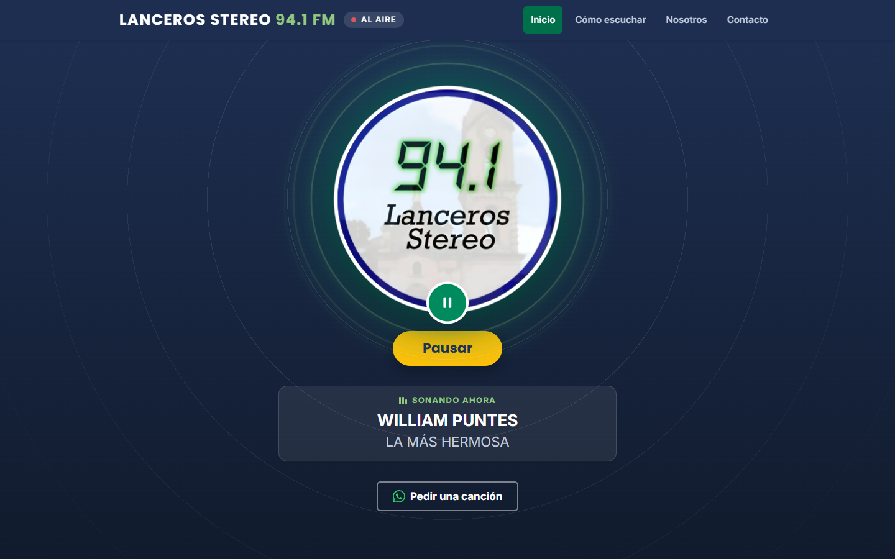
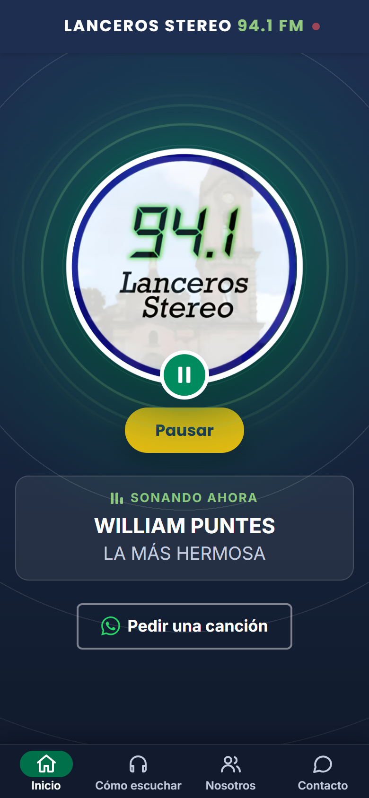
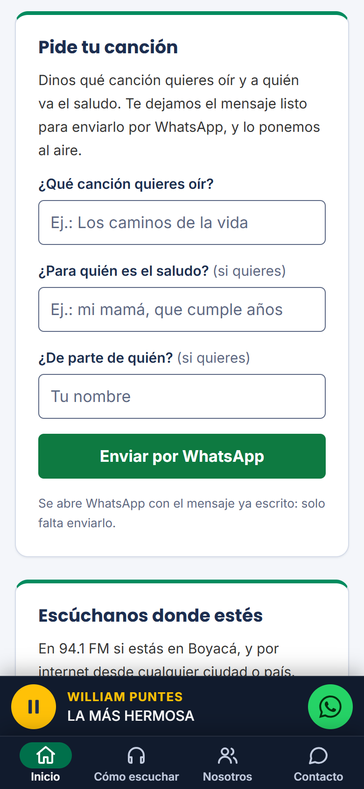
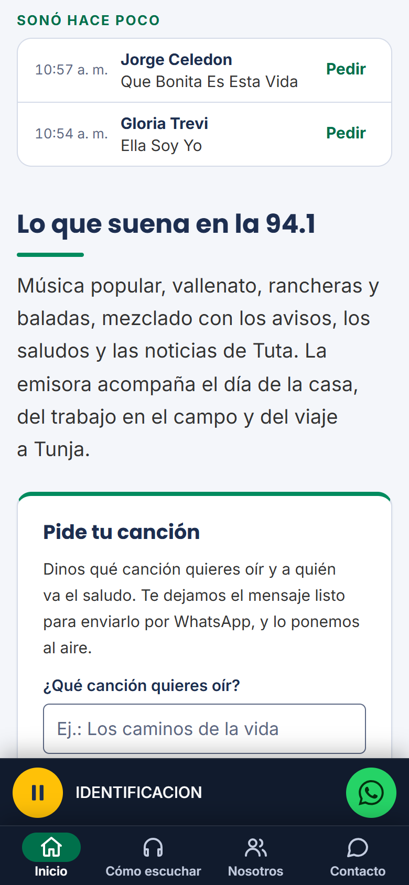
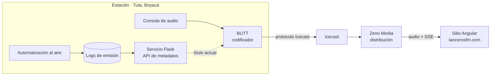

<p align="center">
  
</p>

<h1 align="center">Lanceros Stereo 94.1 FM</h1>

<p align="center">
  Sitio web y reproductor en vivo de la emisora comunitaria de Tuta, Boyacá.<br>
  <a href="https://www.lancerosfm.com/"><b>www.lancerosfm.com</b></a>
</p>

<p align="center">
  
</p>

Lanceros Stereo transmite en el 94.1 FM desde Tuta. La señal cubre el municipio y sus vecinos; el sitio es para el resto de la audiencia: la familia que vive en Bogotá o fuera del país, la gente que se fue a trabajar a otra ciudad y quien prefiere oír la emisora en el celular.

Técnicamente es una aplicación Angular 22 prerenderizada y sin backend propio. El audio y el título de la canción llegan directo de Zeno Media al navegador; lo demás es HTML estático servido desde Vercel.

**Stack:** Angular 22 (señales, sin zone.js) · TypeScript 6 · SCSS · Vitest 4 + jsdom · ESLint · Vercel

## En el celular

<table>
  <tr>
    <td align="center" width="33%"></td>
    <td align="center" width="33%"></td>
    <td align="center" width="33%"></td>
  </tr>
  <tr>
    <td align="center"><sub>Portada</sub></td>
    <td align="center"><sub>Pedir una canción</sub></td>
    <td align="center"><sub>Sonó hace poco</sub></td>
  </tr>
</table>

## Funcionalidades

### Reproducción

- La portada muestra solo lo que hace falta para escuchar: el botón de reproducir, la canción al aire y un acceso para pedir canciones. El resto del contenido queda debajo.
- La barra del reproductor está fuera del `router-outlet`, así que el audio no se corta al cambiar de página. Mientras el botón grande de la portada está a la vista, la barra se oculta para no duplicarlo.
- Si se cae la conexión, el reproductor reintenta a los 1, 2, 4, 8 y 15 segundos y se reanuda solo cuando el navegador vuelve a estar en línea.
- Al pausar se libera la fuente de audio. Un directo no se puede reanudar: sin esto, al volver a reproducir sonaría el audio que quedó en el buffer.
- El volumen se guarda entre visitas (nunca por debajo del 20 %, para que nadie vuelva a una emisora muda). En iPhone y iPad no se muestra el deslizador porque el sistema no permite cambiar el volumen desde la página.
- La barra espaciadora pausa y reanuda desde cualquier página, salvo cuando el foco está en un campo de texto, un enlace o un botón.

### Canción al aire

- El título llega por Server-Sent Events y aparece en la portada, en la barra, en el título de la pestaña y en la pantalla de bloqueo del celular (MediaSession).
- «Sonó hace poco» guarda las últimas cinco canciones que sonaron con la página abierta, cada una con un enlace para pedirla otra vez. Las cuñas y avisos que llegan sin artista no entran en la lista.

### Peticiones

- El formulario de la portada no envía nada al servidor: arma el mensaje con la canción, el saludo y el remitente, y abre WhatsApp con el texto ya escrito. Ningún campo es obligatorio.

### Aplicación instalable

- «Cómo escuchar» ofrece la instalación según el dispositivo: un botón en navegadores Chromium, los pasos con iconos en iPhone y iPad, e indicaciones generales en los demás.
- Con el service worker, la segunda visita carga sin red. Las actualizaciones nunca interrumpen la reproducción (ver [Service worker](#service-worker-y-actualizaciones)).

### Navegación, SEO y accesibilidad

- En el celular la navegación es una fila de pestañas abajo, al alcance del pulgar; en pantallas anchas va en la cabecera. Ambas leen la misma lista de `layout/navigation.ts`.
- Cada ruta se prerenderiza con su título, descripción y URL canónica. Datos estructurados `RadioStation`, `WebSite`, `FAQPage` y `BreadcrumbList`, más `sitemap.xml` y `robots.txt`.
- Un `<h1>` por página, enlace para saltar al contenido, foco visible, anuncios `aria-live` al cambiar de canción y respeto por `prefers-reduced-motion`.
- Cabeceras de seguridad en `vercel.json`: CSP, HSTS, `X-Content-Type-Options`, `X-Frame-Options`, `Referrer-Policy`, `Permissions-Policy` y `Cross-Origin-Opener-Policy`.

### Páginas

| Ruta             | Contenido                                                   |
| ---------------- | ----------------------------------------------------------- |
| `/`              | Reproductor, canciones recientes, peticiones y presentación |
| `/como-escuchar` | Radio, celular y app instalada; preguntas frecuentes        |
| `/nosotros`      | La emisora, el municipio, cómo llega la señal y el equipo   |
| `/contacto`      | WhatsApp, teléfono, correo, dirección, redes y horario      |

## Puesta en marcha

Requiere Node.js `^22.22.3`, `^24.15.0` o `>=26` (los rangos que admite Angular 22).

```bash
npm install
npm start
```

El servidor de desarrollo queda en `http://localhost:4200/`. En desarrollo el service worker está desactivado: para probar la instalación o el modo sin conexión hay que compilar y servir `dist/lancerosfm/browser` con un servidor estático.

| Comando                 | Qué hace                                                         |
| ----------------------- | ---------------------------------------------------------------- |
| `npm start`             | Servidor de desarrollo                                           |
| `npm run build`         | Compilación de producción; prerenderiza todas las rutas y la 404 |
| `npm test`              | Pruebas con Vitest en modo observación                           |
| `npm run test:coverage` | Pruebas una sola vez, con informe de cobertura                   |
| `npm run lint`          | ESLint sobre TypeScript y plantillas                             |
| `npm run format`        | Prettier sobre `src/`                                            |

## Cómo llega el audio



Audio y título viajan por canales distintos. Para que el oyente vea el nombre de la canción que realmente está sonando, el metadato se inyecta en el codificador (BUTT) y no después.

La automatización a veces manda valores de relleno en el campo de artista (`unknown`, `artist`, `desconocido`, `n/a`) y marca las promociones con `PROMOCION`. `parseTrack` en `player/track.ts` los descarta; si aparece uno nuevo, se agrega a esa expresión regular.

## Estructura

El código sigue la [guía de estilo de Angular](https://angular.dev/style-guide): se agrupa por área funcional, no por tipo de archivo.

```
src/
├── main.ts / main.server.ts    Arranque en el navegador y en el prerender
├── styles.scss                 Reset y base global
├── styles/
│   ├── _tokens.scss            Colores, tipografía y espaciado
│   ├── _fonts.scss             Tipografías auto-hospedadas
│   └── _ui.scss                Botones, tarjetas y secciones compartidas
└── app/
    ├── app.ts                  Raíz: cabecera, rutas, reproductor, pestañas, pie
    ├── app.config.ts           Enrutador, hidratación, service worker
    ├── app.routes.ts           Rutas
    ├── app.routes.server.ts    Qué se prerenderiza
    │
    ├── station/                Datos de la emisora y del equipo
    ├── player/
    │   ├── radio-player.ts     Audio, reconexión, metadatos, MediaSession
    │   ├── track.ts            Tipos y lectura del título al aire
    │   ├── live-player-*.ts    Avisa a la barra si el botón grande está a la vista
    │   ├── player-bar/         Barra fija inferior
    │   └── recent-tracks/      «Sonó hace poco»
    ├── request/                Formulario y redacción del mensaje de petición
    ├── pwa/                    Instalación y política de actualizaciones
    ├── seo/                    Metadatos por página y JSON-LD
    ├── share/                  Compartir la emisora
    ├── toasts/                 Avisos temporales
    ├── icons/                  Iconos como componentes
    ├── layout/                 Cabecera, pestañas, pie, contacto flotante
    └── pages/                  Una carpeta por ruta
```

Convenciones:

- Nombres sin sufijo, como genera Angular 22: `radio-player.ts` exporta `RadioPlayer`. Cada componente tiene su `.ts`, `.html`, `.scss` y `.spec.ts` en la misma carpeta.
- Código en inglés, contenido en español. Clases, variables e ids en inglés; URL, textos, comentarios y descripciones de pruebas en español, porque los leen la audiencia y quien mantiene el sitio.
- Estado con señales, dependencias con `inject()`, `protected` para lo que solo usa la plantilla y la propiedad `host` en lugar de `@HostListener`.
- TypeScript y plantillas en modo estricto.
- `RadioPlayer` es lo único que toca el elemento `<audio>`, y `PageMetadata` lo único que escribe en `<head>`.
- Lo que no hace falta para pintar la primera pantalla (formulario de petición, canciones recientes, burbuja de contacto) se carga con `@defer`.

## Service worker y actualizaciones

La política está en `pwa/app-updates.ts`:

1. No se actualiza mientras suena la emisora, porque recargar corta el audio.
2. No se actualiza con la pestaña visible. La versión nueva se aplica cuando la pestaña pasa a segundo plano.
3. Si no hay un buen momento, no se fuerza: queda instalada y se usa en la siguiente visita.

Tres detalles de configuración que no conviene deshacer:

- La reserva de navegación es `/index.csr.html`. Con prerender activo, el builder apunta el service worker a ese archivo, y tiene que estar en el grupo precacheado de `ngsw-config.json`; si no, la portada no abre sin conexión.
- `ngsw-worker.js` y `ngsw.json` se sirven sin caché. Son los que anuncian una versión nueva; con la caché inmutable del resto del JavaScript, la actualización nunca llegaría.
- Un cambio que solo toca `vercel.json` no refresca el service worker, porque `ngsw.json` resume la salida del build, no las cabeceras. Quien ya tenga el sitio instalado conserva las cabeceras anteriores hasta el siguiente despliegue que cambie algo compilado.

## Pruebas y calidad

Antes de publicar, estos tres comandos tienen que pasar sin errores:

```bash
npm run lint
npm run test:coverage
npm run build
```

Las pruebas corren con Vitest sobre jsdom, a través del constructor de pruebas de Angular. La cobertura mínima es 100 % en sentencias, ramas, funciones y líneas (umbrales en `angular.json`): una línea nueva sin probar hace fallar `test:coverage`. El informe queda en `coverage/lancerosfm/` (`lcov.info` para SonarQube, `lcov-report/index.html` para el navegador).

Lo que conviene saber antes de escribir una prueba:

- jsdom no reproduce audio ni trae `EventSource`, `matchMedia`, `IntersectionObserver` ni MediaSession. Las pruebas usan dobles que disparan los eventos a mano; `radio-player.spec.ts` y `player-bar.spec.ts` sirven de modelo.
- Las pruebas comparten proceso. Lo que se cambie en `globalThis` se restablece en el `afterEach` con `vi.unstubAllGlobals()`.
- Importar la configuración del servidor activa `ngServerMode` en todo el proceso (lo hace `provideServerRendering` al evaluarse). Por eso `main.server.spec.ts` la importa dentro de la prueba y restablece el valor.

El estilo lo fijan ESLint (reglas recomendadas de TypeScript y Angular, más las de accesibilidad en plantillas) y Prettier (100 columnas, comillas simples).

### SonarQube

Último análisis: 20 de noviembre de 2026, SonarQube 26.4 con los perfiles _Sonar way_ de TypeScript, CSS y HTML.

| Indicador                                 | Resultado                                                   |
| ----------------------------------------- | ----------------------------------------------------------- |
| Puerta de calidad                         | Aprobada                                                    |
| Fiabilidad · Seguridad · Mantenibilidad   | A · A · A                                                   |
| Bugs · Vulnerabilidades · _Code smells_   | 0 · 0 · 0                                                   |
| _Security hotspots_                       | 0                                                           |
| Cobertura                                 | 100 % de líneas y 100 % de ramas                            |
| Código duplicado                          | 0 %                                                         |
| Deuda técnica                             | 0 min                                                       |
| Tamaño analizado (sin contar las pruebas) | 4238 líneas: 1936 de SCSS, 1380 de TypeScript y 922 de HTML |

Las 269 pruebas, en 33 archivos, se analizan aparte con las reglas para código de prueba y tampoco tienen incidencias. La puerta exige, sobre el código nuevo, cero incidencias, al menos 80 % de cobertura y como máximo 3 % de duplicación; el umbral de cobertura que de verdad manda es el 100 % de `angular.json`, que se cumple antes de llegar al análisis.

`sonar-project.properties` no está en el repositorio porque lleva el token. Lo mínimo que debe tener:

```properties
sonar.projectKey=lancerosfm
sonar.host.url=http://localhost:9000
sonar.token=<token de análisis>
# Sin esto, el escáner en Windows corrompe las tildes.
sonar.sourceEncoding=UTF-8
sonar.sources=src
sonar.tests=src
sonar.test.inclusions=**/*.spec.ts
sonar.exclusions=**/*.spec.ts
sonar.javascript.lcov.reportPaths=coverage/lancerosfm/lcov.info
```

Con ese archivo en la raíz, `npm run test:coverage` seguido de `npx sonar-scanner` publica el análisis con la cobertura.

## Editar el contenido

- Teléfono, dirección, redes, lema y URLs del stream: `src/app/station/station.ts`.
- Equipo de locución: `src/app/station/team.ts`. Está vacío a propósito porque nombra personas reales; al agregar entradas, la sección aparece sola en «Nosotros».
- Logo: los originales están en `public/img/brand/`. Si cambia, hay que regenerar los derivados de 256 y 512 px (AVIF, WebP y PNG) en `public/img/`, que es lo único que entra en la caché del service worker.
- Capturas de este README: `docs/screenshots/`, tomadas de la compilación de producción a 1440 × 900 y 390 × 844 (×2). Están fuera de `public/` para que no se publiquen con el sitio.

## Despliegue

Sitio estático en Vercel, sin funciones serverless ni variables de entorno.

| Parámetro              | Valor                                             |
| ---------------------- | ------------------------------------------------- |
| Comando de compilación | `npm run build`                                   |
| Directorio de salida   | `dist/lancerosfm/browser`                         |
| Cabeceras              | Seguridad y caché en [`vercel.json`](vercel.json) |

Los archivos con hash se sirven con caché inmutable de un año; el HTML se revalida en cada visita.

### Dominios

| Dominio                 | Configuración en Vercel             | Comportamiento                       |
| ----------------------- | ----------------------------------- | ------------------------------------ |
| `www.lancerosfm.com`    | Production                          | Dominio principal                    |
| `lancerosfm.com`        | Redirect 308                        | Lleva a `www.lancerosfm.com`         |
| `lancerosfm.online`     | Production (redirige `vercel.json`) | Dominio anterior; lleva al principal |
| `www.lancerosfm.online` | Production (redirige `vercel.json`) | Dominio anterior; lleva al principal |

El dominio principal tiene que coincidir con `origin` en `station.ts`, con `public/sitemap.xml` y con `public/robots.txt`: de ahí salen la URL canónica y las que lee Google.

**Por qué el dominio anterior no redirige desde el panel de Vercel.** Quien visitó `lancerosfm.online` tiene el service worker instalado, y este sirve la portada desde caché sin tocar la red, así que nunca ve una redirección. La única forma de sacarlo es su propia regla de seguridad: se desinstala y borra la caché cuando `ngsw.json` responde 404. Una redirección del panel impide que llegue ese 404 (el navegador la trata como falta de conexión), por eso las reglas están en `vercel.json`:

1. En el dominio anterior, `ngsw.json` apunta a un archivo que no existe y el service worker se retira.
2. Todo lo demás redirige con 308 a la misma ruta en `www.lancerosfm.com`.

Cada oyente queda migrado en su segunda visita. Las reglas deben mantenerse mientras se conserve `lancerosfm.online`.

## Licencia

© Lanceros Stereo 94.1 FM. Todos los derechos reservados.

Las tipografías Inter y Poppins se distribuyen bajo la SIL Open Font License 1.1 (`public/fonts/OFL.txt`).
